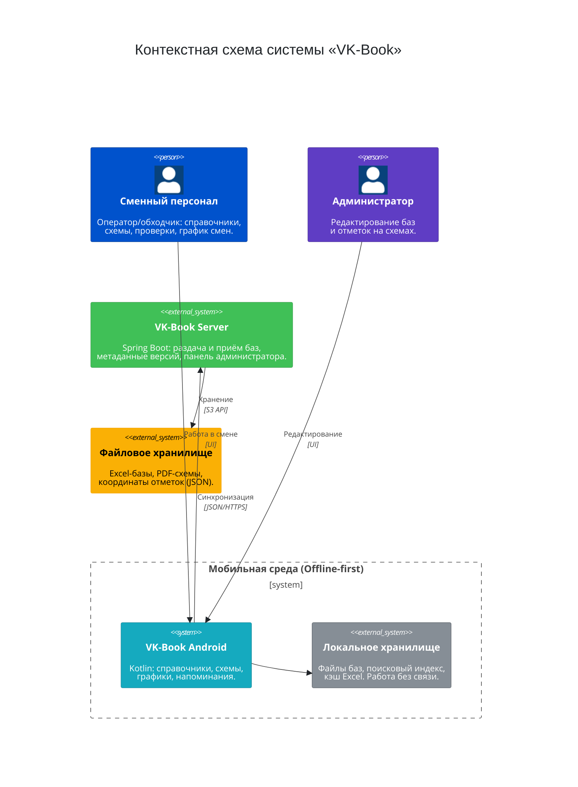
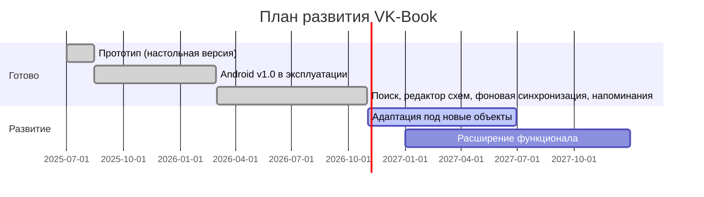
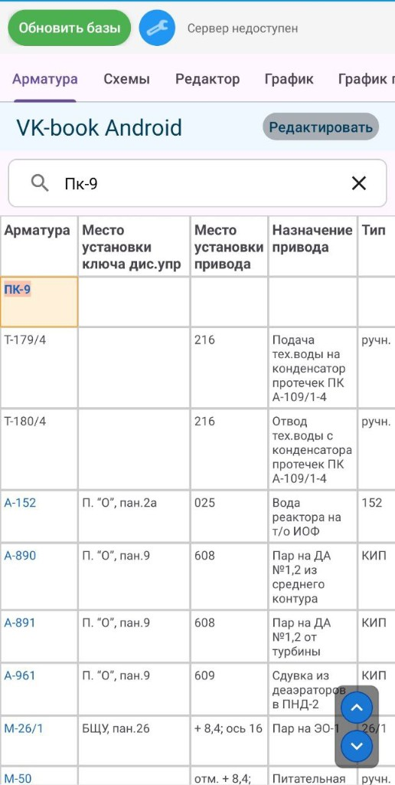
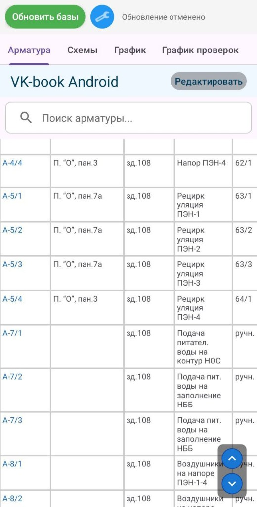
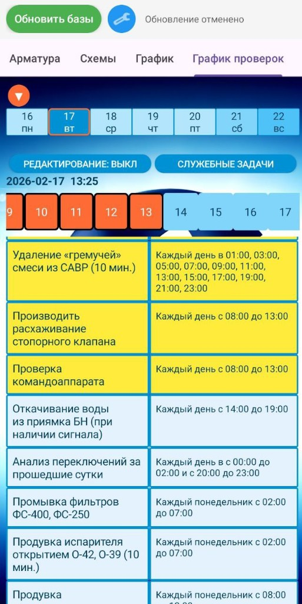
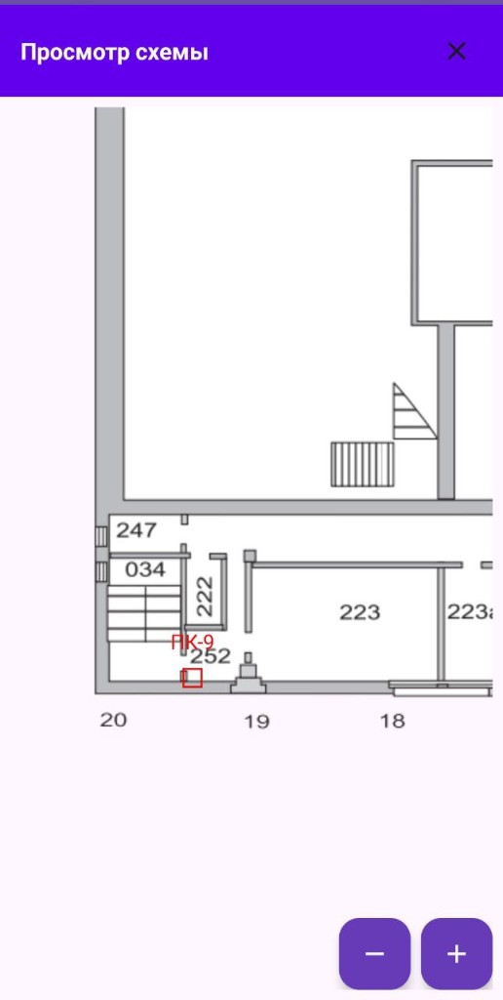
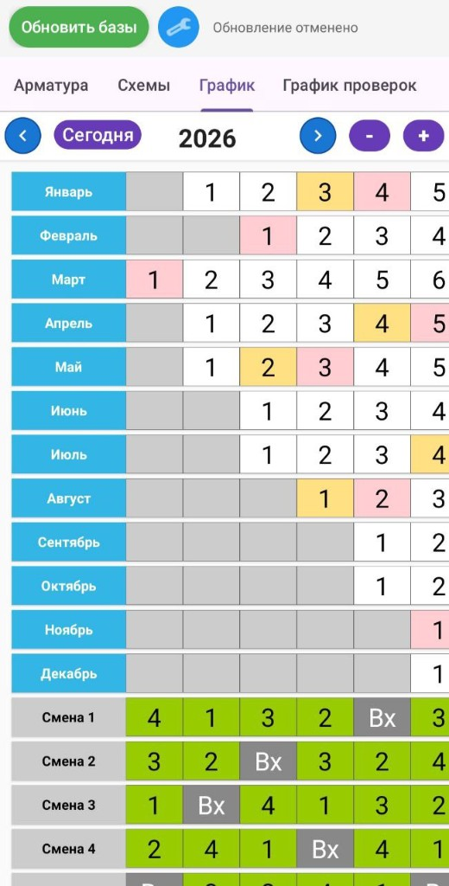

# 📱 VK-Book Android — Technical Showcase

> **Мобильная платформа цифрового рабочего места сменного персонала промышленных объектов**

**Статус:** `Production Ready` — приложение используется сменным персоналом в ежедневной работе  
**Роль:** Technical Product Manager / Системный архитектор (AI-native подход)

VK-Book Android — мобильное приложение и серверная часть для оцифровки рабочих процессов сменного персонала на промышленных объектах с непрерывным циклом работы. Справочники оборудования, схемы с отметками оборудования, графики проверок и графики смен собраны в одном телефоне и работают без связи.

> Этот репозиторий — **витрина** проекта: описание возможностей, архитектура и скелет кода. Рабочей версии приложения здесь нет. Внедрение на вашем объекте обсуждается индивидуально — см. раздел [«Сотрудничество»](#-сотрудничество).

---

## ⚠️ Какие задачи решает продукт

* **Информационный хаос.** Данные по оборудованию разбросаны по бумажным журналам и разным Excel-таблицам; поиск нужной позиции отнимает время.
* **Операционные риски.** Большое количество оборудования приводит к ошибкам навигации у новичков и ошибкам по невнимательности у опытных сотрудников.
* **Пропуски регламентных проверок.** Плотный график проверок по часам легко упустить в течение смены.
* **Нет данных на месте.** В помещениях без стационарных ПК и без связи нет доступа к схемам и справочникам.

---

## ✨ Возможности

### 🔎 Справочники оборудования (Арматура, КИП, Сигналы БЩУ)
* Таблицы строятся из Excel-файлов заказчика: ручной ввод данных не нужен.
* Мгновенный поиск по всем столбцам или по выбранному столбцу с подсветкой совпадений.
* Собственный поисковый индекс на устройстве: поиск работает офлайн даже по большим таблицам.
* Поиск понимает разные варианты записи обозначений: похожие латинские и кириллические буквы, «ё» и «е», разные виды дефисов, точки и слэши.
* Один запрос применяется сразу ко всем справочникам при переключении вкладок.
* Настраиваемая ширина и порядок столбцов, быстрая прокрутка.

### 🗺 Схемы и планы с отметками оборудования
* Нажатие на позицию в справочнике открывает план или схему с отмеченным местом оборудования.
* Если позиция есть на нескольких схемах — приложение предложит выбрать нужную.
* Масштабирование жестами и кнопками, при приближении участок перерисовывается в высоком качестве.
* Встроенный просмотр PDF без сторонних библиотек.

### ✅ График проверок
* Шкала на 36 часов (вечер предыдущего дня, текущий день, утро следующего) с подсветкой часов текущей смены.
* Служебные проверки загружаются из Excel-графика; личные задачи сотрудник ведёт сам.
* Гибкие правила повторения: по часам и дням недели, по числам месяца, «N-й день недели месяца».
* Выбор нескольких часов и дат — нужные задачи поднимаются наверх.

### 🔔 Напоминания о проверках в течение смены
* Сотрудник один раз выбирает свою смену — дальше приложение само напоминает о проверках его смены.
* Режимы: «один раз в начале смены» или «во время смены каждые N минут».
* Можно выбрать, о каких проверках напоминать, а какие отключить.
* Отдельное уведомление по каждой текущей проверке с кнопкой **«Выполнено»** — отмеченная проверка до конца смены больше не напоминает.
* Напоминания восстанавливаются после перезагрузки телефона и смены времени.
* Разрешения запрашиваются только при включении напоминаний, с объяснением, зачем они нужны.

### 📅 График смен
* Годовой календарь сменности бригад с переходом между годами.
* График рассчитывается автоматически в обе стороны от любой даты.
* Масштабирование таблицы и подсветка выбранного дня.

### 🔄 Обновление данных и работа без связи
* Все базы хранятся на устройстве: справочники, схемы и графики доступны без интернета.
* Обновление баз с сервера одной кнопкой — в фоне, с уведомлением о прогрессе; можно свернуть приложение.
* По желанию — автоматическое фоновое обновление по расписанию.
* Каждый файл проверяется по контрольной сумме SHA-256; одинаковые файлы повторно не скачиваются, замена файлов атомарная.

### 🛠 Администрирование
* Административные функции скрыты от обычных пользователей и защищены паролем.
* Встроенный редактор Excel-баз (справочники, график проверок) с отменой и повтором действий.
* Редактор отметок на схемах: добавление, перемещение, подписи, цвет и размер отметок.
* Отправка обновлённых баз на сервер — после этого их получают все пользователи.
* Перенос баз между устройствами через ZIP-архив.

### 🎨 Интерфейс
* 6 тем оформления, включая корпоративную, светлый и тёмный режимы.
* Набор видимых вкладок настраивается под роль сотрудника.

---

## ⚙️ Технологический стек

Проект реализован по методологии **Vibe Coding** — стратегическое управление разработкой через ИИ-агентов Cursor при сохранении архитектурной целостности и покрытия тестами.

| Слой | Технологии |
|------|------------|
| **Mobile** | Kotlin 2.0, Material Components, ViewPager2, RecyclerView, Coroutines, minSdk 26 (Android 8.0+) |
| **Данные на устройстве** | Файловое хранилище, собственный поисковый индекс (memory-mapped файлы), постраничный кэш Excel |
| **Excel** | Apache POI 5.2.5 — чтение и запись .xlsx |
| **PDF** | Встроенный Android PdfRenderer |
| **Сеть** | Retrofit 2, OkHttp 4, Gson |
| **Фоновые задачи** | WorkManager (синхронизация), AlarmManager (напоминания) |
| **Безопасность** | Хеширование паролей, EncryptedSharedPreferences, проверка SHA-256 файлов |
| **Backend** | Java 21, Spring Boot 3, Spring Security, Spring Data JPA, PostgreSQL, S3-совместимое хранилище файлов, веб-панель администратора |
| **Тестирование** | JUnit, Robolectric, Espresso, JaCoCo |

---

## 📊 Качество и результаты

* **Автотесты:** более 480 тестов — 406 модульных (JUnit, Robolectric) и 75 инструментальных (Espresso).
* **Офлайн-режим:** все рабочие функции доступны без связи с сервером.
* **Целостность данных:** каждое обновление баз проверяется по SHA-256.
* **Бизнес-эффект:** продукт признан руководством готовым к эксплуатации; получена премия за вклад в цифровую трансформацию предприятия.

---

## 🏗 Архитектура системы

> **При просмотре с телефона:** приложение GitHub на Android не отображает диаграммы — показывается исходный код. Чтобы увидеть схемы, откройте репозиторий в **браузере** на телефоне или на ПК.

### 🛠 Архитектурные принципы

- **Слоистая архитектура** — интерфейс (фрагменты) отделён от сервисов, репозиториев и источников данных.
- **SOLID и малые политики** — правила синхронизации, поиска и напоминаний вынесены в отдельные классы, которые тестируются независимо.
- **Repository Pattern** — абстракция работы с локальными файлами и сервером.
- **Strategy Pattern** — темы оформления и способы сохранения отметок на схемах.
- **Coordinator** — координаторы синхронизации, индексации поиска и сохранения схем.
- **Cache Pattern** — LRU-кэши и постраничный кэш для больших таблиц.

---

## 🗺 Product Roadmap

Подробнее — в [docs/Roadmap.md](docs/Roadmap.md).

---

## 📸 Скриншоты

| Арматура (поиск) | Арматура (список) | График проверок |
|------------------|-------------------|-----------------|
|  |  |  |

| Схема с отметкой оборудования | График смен |
|-------------------------------|-------------|
|  |  |

---

## 📚 Документация

- **[PRD.md](docs/PRD.md)** — требования к продукту: проблемы, функции, метрики
- **[ADR.md](docs/ADR.md)** — архитектурные решения и их обоснование
- **[User_Stories.md](docs/User_Stories.md)** — пользовательские истории
- **[Roadmap.md](docs/Roadmap.md)** — план развития
- **[Architecture/](docs/Architecture/)** — диаграммы C4 и последовательностей

---

## 🤝 Сотрудничество

Платформа рассчитана на адаптацию под другие объекты со сменным персоналом:

* **Ваши данные.** Справочники, графики проверок и схемы подключаются из ваших Excel- и PDF-файлов.
* **Ваш график.** Настройка под вашу сменность и состав вкладок под роли сотрудников.
* **Ваш сервер.** Развёртывание серверной части в вашей инфраструктуре.
* **Сопровождение.** Доработка функций под ваши процессы.

**Как связаться:** через профиль GitHub [@Flashw0rk](https://github.com/Flashw0rk).

---

## 🔒 Защита интеллектуальной собственности

- Репозиторий содержит только описание и архитектурный скелет кода — реализация методов скрыта.
- Код витрины не компилируется и не запускается.
- Полная реализация, демонстрация и условия использования — по договорённости.

См. [LICENSE](LICENSE).

---

**© 2025–2026 Плющик Станислав Викторович. All Rights Reserved.**
