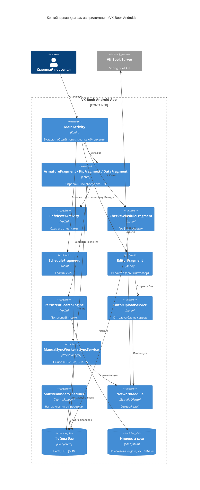

# C4 Container Diagram
## VK-Book Android

## Описание контейнеров

### MainActivity
Главный экран: вкладки (ViewPager2), общая строка поиска для справочников, кнопка обновления баз.

### Экраны
- **ArmatureFragment / KipFragment / DataFragment** — справочники «Арматура», «КИП» и «Сигналы БЩУ» на общей табличной основе; переход к схеме по нажатию
- **PdfViewerActivity** — просмотр плана или схемы с отметкой оборудования
- **ChecksScheduleFragment** — график проверок
- **ScheduleFragment** — график смен
- **EditorFragment** — редактор баз и отметок (только администратор)

### Сервисы
- **PersistentSearchEngine** — собственный поисковый индекс на устройстве
- **EditorUploadService** — отправка отредактированных баз на сервер с повторными попытками
- **ManualSyncWorker / SyncService** — фоновое обновление баз с проверкой SHA-256
- **ShiftReminderScheduler** — планирование напоминаний о проверках смены
- **NetworkModule** — сетевой слой (Retrofit, OkHttp)

### Хранилища
- **Файлы баз** — Excel, PDF и JSON с координатами отметок
- **Индекс и кэш** — поисковый индекс и постраничный кэш таблиц
