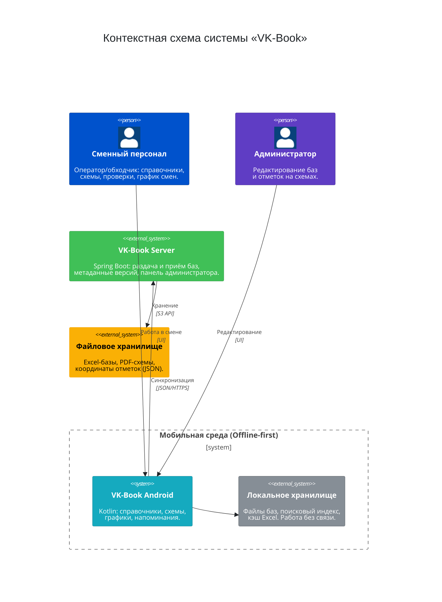

# C4 System Context Diagram
## VK-Book Android

## Описание компонентов

### Сменный персонал
Операторы и обходчики: поиск оборудования, схемы, график проверок, напоминания, график смен.

### Администратор
Редактирует справочники и отметки на схемах, публикует обновлённые базы на сервер. Доступ защищён паролем.

### VK-Book Android
Мобильное приложение на Kotlin. Все рабочие функции доступны без связи.

### Локальное хранилище
Файлы баз (Excel, PDF, JSON), собственный поисковый индекс и постраничный кэш таблиц на устройстве.

### VK-Book Server
Серверная часть на Spring Boot: список и раздача файлов, метаданные версий для проверки обновлений, приём баз от администратора, веб-панель управления.

### Файловое хранилище
S3-совместимое хранилище исходных файлов баз.
