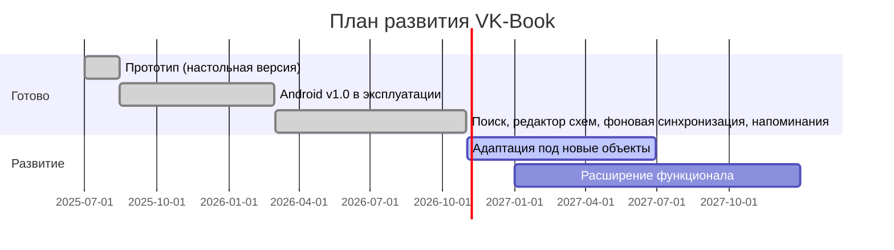

# Product Roadmap
## VK-Book Android

**Версия:** 2.0  
**Дата:** Октябрь 2026

---

## Обзор

План развития VK-Book: от настольного прототипа до мобильной платформы, готовой к адаптации под другие объекты со сменным персоналом.

---

## Roadmap Timeline

---

## Этап 1: Прототип (2025)

**Статус:** ✅ Завершено

- Настольный справочник на Java: поиск по документации и сигналам оборудования
- Проверка гипотезы: быстрый поиск экономит время реагирования персонала

---

## Этап 2: Android v1.0 (2025–2026)

**Статус:** ✅ Завершено — приложение в эксплуатации

- Справочники «Арматура», «КИП», «Сигналы БЩУ» из Excel
- Просмотр планов и схем с отметками оборудования
- График проверок с подсветкой текущего часа
- Годовой график смен
- Офлайн-работа и обновление баз с сервера
- Серверная часть на Spring Boot
- Признание руководством и премия за вклад в цифровую трансформацию предприятия

---

## Этап 3: Развитие платформы (2026)

**Статус:** ✅ Завершено

- Собственный поисковый индекс: поиск при разном написании обозначений
- Общий поисковый запрос для всех справочников
- Редактор отметок на схемах и встроенный редактор Excel-баз
- Фоновое обновление баз через WorkManager, проверка SHA-256
- Напоминания о проверках в течение смены с кнопкой «Выполнено»
- Запрос разрешений только там, где без них функция не работает
- Более 480 автотестов

---

## Этап 4: Адаптация под новые объекты (2026–2027)

**Статус:** 🔄 В процессе

**Задачи:**
- [ ] Настройка графика сменности под предприятие (число бригад, цикл, время смен)
- [ ] Шаблоны Excel-файлов и инструкция по подготовке данных заказчиком
- [ ] Развёртывание серверной части в инфраструктуре заказчика
- [ ] Демонстрационный набор данных для презентаций

---

## Этап 5: Расширение функционала (2027)

**Статус:** 📋 Запланировано

**Задачи:**
- [ ] Просмотр многостраничных PDF-документов
- [ ] Заметки к дням в графике смен
- [ ] Журнал выполненных проверок за смену
- [ ] Расширение набора справочников под нужды заказчиков

---

## Приоритизация

### Высокий приоритет
1. Настройка графика сменности под предприятие
2. Развёртывание сервера у заказчика
3. Демонстрационный набор данных

### Средний приоритет
1. Многостраничные PDF
2. Журнал выполненных проверок

### Низкий приоритет
1. Заметки в графике смен

---

## Риски и митигация

| Риск | Вероятность | Влияние | Митигация |
|------|-------------|---------|-----------|
| Разные форматы данных у заказчиков | Высокая | Среднее | Шаблоны файлов, гибкий разбор Excel |
| Требования безопасности заказчика | Средняя | Высокое | Сервер в контуре заказчика, данные не покидают предприятие |
| Изменение требований | Средняя | Среднее | Слоистая архитектура, малые независимые классы |

---

## Заключение

Ядро продукта готово и работает в эксплуатации. Следующий шаг — адаптация под новые объекты: настройка сменности, шаблоны данных и развёртывание у заказчика.
